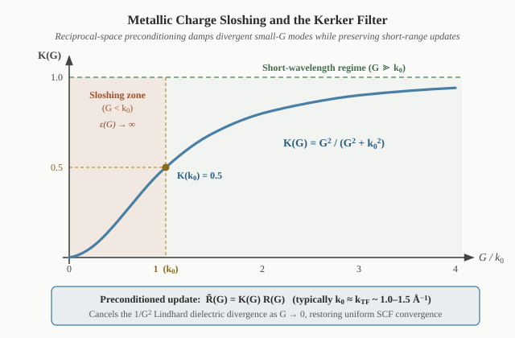

# SCF Convergence and Density Mixing

Chapters 8 and 9 assembled the internal Kohn–Sham machinery within a single iteration:
iterative subspace diagonalisation (Chapter 8) produces the eigenpairs at each
\\(\mathbf{k}\\)-point for a fixed effective potential, and Brillouin zone integration and
smearing (Chapter 9) assign occupations across the Fermi surface to form the output density
\\(\rho\_{\rm out}(\mathbf{r})\\). Together, they define one complete pass of the Kohn–Sham map
\\(\rho\_{\rm in} \mapsto \rho\_{\rm out} = F[\rho\_{\rm in}]\\) introduced in Chapter 3
(Section 3.4). This chapter addresses the **middle loop** that wraps around both steps: the
**density update** — how the output density from one KS cycle is combined with the input
density to produce the next iterate, and under what conditions this non-linear fixed-point
iteration converges.

Consider a concrete example. A spin-polarised calculation on a \\(4 \times 4 \times 4\\) supercell
of bcc Fe (\\(128\\) atoms, \\(\sim 50\\,000\\) plane waves per \\(\mathbf{k}\\)-point) will not converge
with naive density iteration at any mixing parameter. The total energy oscillates indefinitely,
swinging by several eV per iteration, because long-wavelength charge fluctuations slosh back
and forth across the metallic Fermi surface with no restoring force. The same system converges
smoothly in \\(\sim 25\\) iterations once Kerker preconditioning and Pulay mixing are applied. The
difference is not a matter of patience — it is a qualitative change from divergence to
convergence, rooted in the dielectric response of the electron gas.

We begin by recasting the SCF cycle as a fixed-point problem and deriving the convergence
condition from the Jacobian of the KS map. The charge-sloshing instability in metals emerges
naturally from the Lindhard dielectric function. With the problem precisely formulated, we
derive the main mixing schemes — linear, Kerker-preconditioned, Pulay/DIIS, and Broyden — as
progressively more sophisticated strategies for reaching the fixed point. The chapter concludes
with the unified electronic SCF **convergence diagnostics toolkit** and a **worked example on
ferromagnetic bcc Fe** that ties together all of Chapters 8–10.

## The Self-Consistency Problem Revisited

### The Fixed-Point Formulation

The SCF cycle of Chapter 3 (Section 3.4) consists of three computational steps: constructing
\\(V\_{\rm eff}[\rho]\\) in the Kohn–Sham equations, diagonalising
\\(\hat{h}\_{\rm KS}\\), and assembling
\\(\rho\_{\rm out} = \sum\_i f\_i |\phi\_i|^2\\). We now recast this cycle as a **fixed-point
problem** whose convergence properties can be analysed rigorously. Define the map \\(F\\) that takes
an input density \\(\rho\_{\rm in}\\) and returns the output density obtained by one full KS cycle:

\begin{equation}
    \rho_{\rm in} \;\xrightarrow{V_{\rm eff}[\rho_{\rm in}]}\;
    \hat{h}_{\rm KS} \;\xrightarrow{\text{diagonalise}}\;
    \{\phi_i, \epsilon_i\} \;\xrightarrow{\sum_i f_i|\phi_i|^2}\;
    \rho_{\rm out} = F[\rho_{\rm in}].
    \label{eq:F-map}
\end{equation}

Self-consistency means finding the density \\(\rho^\*\\) that is a fixed point of \\(F\\):

\begin{equation}
    \boxed{F[\rho^*] = \rho^*.}
    \label{eq:fixed-point}
\end{equation}

The **residual** at iteration \\(n\\) measures the distance from self-consistency:

\begin{equation}
    R^{(n)} = F[\rho_{\rm in}^{(n)}] - \rho_{\rm in}^{(n)} = \rho_{\rm out}^{(n)} - \rho_{\rm in}^{(n)}.
    \label{eq:residual}
\end{equation}

All mixing schemes can be understood as strategies to drive \\(\\|R^{(n)}\\| \to 0\\) as efficiently
as possible. The simplest strategy — feeding the output density directly back as the next
input, \\(\rho\_{\rm in}^{(n+1)} = \rho\_{\rm out}^{(n)}\\) — corresponds to a naive fixed-point
iteration. Whether this converges depends on the properties of \\(F\\).

### The Jacobian and Convergence Conditions

Linearising \\(F\\) around the fixed point \\(\rho^\*\\), the residual evolves as:

\begin{equation}
    R^{(n+1)} \approx J \cdot R^{(n)}, \qquad J_{ij} = \left.\frac{\delta F[\rho]_i}{\delta \rho_j}\right|_{\rho = \rho^*},
    \label{eq:jacobian}
\end{equation}

where \\(J\\) is the **Jacobian** of the map \\(F\\), and the indices \\(i, j\\) run over the
discretisation of the density (e.g., plane-wave coefficients \\(\rho(\mathbf{G})\\)). The iteration
converges if and only if the **spectral radius** of \\(J\\) is less than unity:

\begin{equation}
    \boxed{|\lambda_{\rm max}(J)| \lt 1,}
    \label{eq:convergence-condition}
\end{equation}

where \\(\lambda\_{\rm max}\\) is the eigenvalue of \\(J\\) with the largest absolute value. When this
condition is violated, the iteration diverges: small perturbations in the density are amplified
rather than damped by successive KS cycles.

### Charge Sloshing: Why Metals Are Difficult

The physical content of the Jacobian becomes transparent in reciprocal space. For a
homogeneous electron gas, the density response to a perturbation of wavevector \\(\mathbf{G}\\) is
governed by the **Lindhard dielectric function**:

\begin{equation}
    \varepsilon(\mathbf{G}) = 1 - \frac{4\pi e^2}{G^2}\chi_0(\mathbf{G}),
    \label{eq:lindhard}
\end{equation}

where \\(\chi\_0(\mathbf{G})\\) is the non-interacting density–density response function of the KS
system. The KS map \\(F\\) relates the output density perturbation to the input perturbation
through the inverse dielectric function: \\(\delta\rho\_{\rm out}(\mathbf{G}) =
\varepsilon^{-1}(\mathbf{G})\\,\delta\rho\_{\rm in}(\mathbf{G})\\). For the Jacobian, this means:

\begin{equation}
    J(\mathbf{G}) \approx 1 - \varepsilon^{-1}(\mathbf{G}).
    \label{eq:J-dielectric}
\end{equation}

For an insulator, there is a finite gap \\(\Delta\\) in the spectrum. The response function
\\(\chi\_0\\) remains bounded as \\(G \to 0\\), the dielectric constant \\(\varepsilon(0)\\) is finite
(typically \\(5\\)–\\(20\\)), and all eigenvalues of \\(J\\) satisfy \\(|\lambda| \lt 1\\). The naive iteration
converges, often rapidly.

For a metal, the situation is qualitatively different. The density of states at the Fermi level
is finite, so \\(\chi\_0(\mathbf{G}) \to -N(\epsilon\_F)\\) as \\(G \to 0\\) (the static Lindhard
limit). The dielectric function diverges as:

\begin{equation}
    \varepsilon(\mathbf{G}) \approx 1 + \frac{k_{\rm TF}^2}{G^2}, \qquad G \to 0,
    \label{eq:eps-metal}
\end{equation}

where \\(k\_{\rm TF} = \sqrt{4\pi e^2 N(\epsilon\_F)}\\) is the **Thomas–Fermi screening wavevector**.
This means \\(\varepsilon^{-1}(\mathbf{G}) \to 0\\) for small \\(G\\), and from equation
\eqref{eq:J-dielectric}:

\begin{equation}
    J(\mathbf{G}) \to 1 \quad \text{as} \quad G \to 0 \quad \text{(metals)}.
    \label{eq:charge-sloshing}
\end{equation}

The Jacobian has eigenvalues arbitrarily close to \\(1\\) for long-wavelength density fluctuations.
These modes are neither damped nor amplified — they **slosh** back and forth between iterations
without converging. This is the **charge-sloshing instability**, the dominant convergence
problem in metallic DFT calculations. Physically, long-wavelength charge fluctuations in a
metal cost very little energy (they are screened only weakly at long range), so the SCF cycle
has no restoring force to drive them toward the self-consistent solution.

The key insight is that the convergence difficulty is *wavevector-dependent*: small-\\(G\\)
components of the density converge slowly or not at all, while large-\\(G\\) components (short
wavelength, within the screening cloud) converge quickly. An effective mixing scheme must
therefore treat different Fourier components differently.

To make this concrete: for fcc Al (a simple metal with \\(k\_{\rm TF} \approx 1.6\\,\\)Å\\(^{-1}\\)),
the Jacobian eigenvalue for the smallest accessible \\(\mathbf{G}\\) in a conventional cell is
\\(\lambda \approx 0.97\\). With simple mixing at \\(\alpha = 0.3\\), the convergence rate for this
mode is \\(|1 - 0.3(1 - 0.97)| = 0.991\\) — meaning each iteration reduces the error by less
than \\(1\\%\\). Reaching \\(10^{-6}\\) convergence in this mode alone would require \\(\sim 1400\\)
iterations. For bcc Fe with a denser Fermi surface, the situation is worse. By contrast, an
insulator like MgO has \\(\varepsilon(0) \approx 10\\), giving \\(\lambda \approx 0.9\\) for the
slowest mode and convergence in \\(\sim 50\\) iterations even with simple mixing — and much faster
with Pulay extrapolation.

## Density Mixing Schemes

With the fixed-point problem and its convergence difficulties established, we now derive the
main mixing strategies used in practice. Each can be understood as a progressively more
sophisticated approach to the same problem: find the fixed point \\(\rho^\* = F[\rho^\*]\\) given
a sequence of input–output pairs \\((\rho\_{\rm in}^{(n)}, \rho\_{\rm out}^{(n)})\\).

### Simple (Linear) Mixing

The simplest improvement over naive iteration is to mix the input and output densities:

\begin{equation}
    \boxed{\rho_{\rm in}^{(n+1)} = \rho_{\rm in}^{(n)} + \alpha\, R^{(n)},}
    \label{eq:linear-mixing}
\end{equation}

where \\(\alpha \in (0, 1]\\) is the **mixing parameter** and \\(R^{(n)} = \rho\_{\rm out}^{(n)} -
\rho\_{\rm in}^{(n)}\\) is the residual. Setting \\(\alpha = 1\\) recovers naive iteration; smaller
\\(\alpha\\) damps the update.

Linearising around the fixed point, the residual evolves as:

\begin{equation}
    R^{(n+1)} = [1 - \alpha(1 - J)]\,R^{(n)}.
    \label{eq:linear-residual}
\end{equation}

The effective iteration matrix is \\(M = 1 - \alpha(1 - J)\\), with eigenvalues
\\(\mu = 1 - \alpha(1 - \lambda)\\) where \\(\lambda\\) is an eigenvalue of \\(J\\). Convergence requires
\\(|\mu| \lt 1\\) for all eigenvalues, which gives the condition:

\begin{equation}
    \alpha \lt \frac{2}{1 + \lambda_{\rm max}}.
    \label{eq:alpha-bound}
\end{equation}

For a metal with \\(\lambda\_{\rm max} \to 1\\) (the charge-sloshing modes), this bound gives
\\(\alpha \lt 1\\) — but the convergence rate for these modes is \\(|1 - \alpha(1 - \lambda)| \approx
1 - \alpha(1 - \lambda\_{\rm max})\\), which is very close to \\(1\\) for small \\(\alpha\\). Convergence
is guaranteed but *extremely slow*: the long-wavelength modes creep toward self-consistency
over hundreds of iterations.

**Typical values:** \\(\alpha \sim 0.01\\)–\\(0.1\\) for metals and magnetic systems; \\(\alpha \sim
0.3\\)–\\(0.7\\) for insulators. The smaller values needed for metals reflect the charge-sloshing
problem directly.

### Kerker Preconditioning

The analysis of charge sloshing reveals that the convergence problem is concentrated at small
\\(\mathbf{G}\\): long-wavelength components of the residual are barely damped, while
short-wavelength components converge quickly. The **Kerker preconditioner** (Kerker, 1981)
addresses this by applying a \\(\mathbf{G}\\)-dependent damping to the residual before mixing.

The idea is to approximate the inverse dielectric function and use it to precondition the
residual. From equation \eqref{eq:eps-metal}, the metallic dielectric function at small \\(G\\) is
dominated by the Thomas–Fermi screening term \\(k\_{\rm TF}^2/G^2\\). The Kerker preconditioner
multiplies the residual in reciprocal space by a filter that suppresses the problematic
small-\\(G\\) components:

\begin{equation}
    \boxed{\tilde{R}^{(n)}(\mathbf{G}) = \frac{G^2}{G^2 + k_0^2}\,R^{(n)}(\mathbf{G}),}
    \label{eq:kerker}
\end{equation}

where \\(k\_0\\) is a parameter with dimensions of inverse length, typically chosen close to
\\(k\_{\rm TF}\\). The preconditioned residual \\(\tilde{R}\\) is then used in place of \\(R\\) in the
mixing formula:

\begin{equation}
    \rho_{\rm in}^{(n+1)} = \rho_{\rm in}^{(n)} + \alpha\,\tilde{R}^{(n)}.
    \label{eq:kerker-mixing}
\end{equation}

The physical interpretation is immediate: the factor \\(G^2/(G^2 + k\_0^2)\\) vanishes as \\(G \to 0\\)
and approaches unity for \\(G \gg k\_0\\). It therefore suppresses the long-wavelength charge
sloshing modes while leaving the well-behaved short-wavelength modes unchanged. At intermediate
wavelengths (\\(G \sim k\_0\\)), the suppression is partial — the preconditioner interpolates
smoothly between complete damping and no damping.

This is equivalent to multiplying the residual by an approximate inverse dielectric function.
If \\(k\_0 = k\_{\rm TF}\\), the preconditioner matches the Thomas–Fermi screening exactly in the
long-wavelength limit, making the preconditioned iteration matrix nearly independent of \\(G\\)
and restoring uniform convergence across all wavevectors.

Computationally, the Kerker preconditioner is very cheap: one forward FFT to go to reciprocal
space, a pointwise multiplication by \\(G^2/(G^2 + k\_0^2)\\), and one inverse FFT to return to
real space. No additional KS cycles or matrix operations are required.

<figure>

<figcaption style="text-align:center; font-size:0.9em; color:#555;">

**Figure 10.1.** The Kerker reciprocal-space filter \\(K(G) = G^2/(G^2 + k\_0^2)\\). Long-wavelength charge-sloshing components (\\(G \lt k\_0\\)), where the metallic dielectric response \\(\varepsilon(G) \propto k\_{\rm TF}^2/G^2\\) diverges, are strongly damped, while short-wavelength density updates (\\(G \gg k\_0\\)) pass through near unity.

</figcaption>
</figure>

**Limitation:** Kerker preconditioning is designed for metallic screening and can *slow down*
convergence in insulators, where the long-wavelength response is already well-behaved. For
insulators, the factor \\(G^2/(G^2 + k\_0^2)\\) unnecessarily suppresses the update at small \\(G\\),
requiring more iterations to reach self-consistency. Most codes therefore apply Kerker
preconditioning only when the system is metallic or when charge sloshing is detected.

### Pulay/DIIS Mixing

Linear mixing, even with Kerker preconditioning, uses only information from the *current*
iteration to construct the update. This is wasteful: by iteration \\(n\\), the SCF cycle has
accumulated \\(n\\) input–output pairs, each containing information about the map \\(F\\) near the
fixed point. **Pulay mixing** (Pulay, 1980), also known as **Direct Inversion in the Iterative
Subspace (DIIS)**, exploits this history by applying the same constrained residual-minimisation
principle used for single-band orbitals in RMM-DIIS (Chapter 8) to the global charge-density
residual \\(R^{(n)} = \rho\_{\rm out}^{(n)} - \rho\_{\rm in}^{(n)}\\).

The idea is to form a linear combination of the \\(m\\) most recent input densities and find the
coefficients that minimise the norm of the corresponding residual. Suppose we have stored the
last \\(m\\) residuals \\(\\{R^{(n)}, R^{(n-1)}, \ldots, R^{(n-m+1)}\\}\\) and the corresponding input
densities \\(\\{\rho\_{\rm in}^{(n)}, \ldots, \rho\_{\rm in}^{(n-m+1)}\\}\\). Construct a trial
input density as:

\begin{equation}
    \bar{\rho}_{\rm in} = \sum_{i=1}^{m} c_i\, \rho_{\rm in}^{(n-m+i)},
    \label{eq:pulay-trial}
\end{equation}

with the constraint \\(\sum\_i c\_i = 1\\) (so that \\(\bar{\rho}\\) integrates to \\(N\\) electrons). If
the map \\(F\\) is approximately linear near the fixed point, the residual of this trial density
is approximately:

\begin{equation}
    \bar{R} \approx \sum_{i=1}^{m} c_i\, R^{(n-m+i)}.
    \label{eq:pulay-residual}
\end{equation}

DIIS minimises \\(\\|\bar{R}\\|^2 = \sum\_{ij} c\_i c\_j \langle R^{(i)} | R^{(j)} \rangle\\) subject
to the constraint \\(\sum\_i c\_i = 1\\). Introducing a Lagrange multiplier \\(\mu\\), the stationarity
conditions give the \\((m+1) \times (m+1)\\) linear system:

\begin{equation}
    \begin{pmatrix}
        B_{11} & B_{12} & \cdots & B_{1m} & 1 \\
        B_{21} & B_{22} & \cdots & B_{2m} & 1 \\
        \vdots & \vdots & \ddots & \vdots & \vdots \\
        B_{m1} & B_{m2} & \cdots & B_{mm} & 1 \\
        1 & 1 & \cdots & 1 & 0
    \end{pmatrix}
    \begin{pmatrix} c_1 \\ c_2 \\ \vdots \\ c_m \\ -\mu \end{pmatrix}
    =
    \begin{pmatrix} 0 \\ 0 \\ \vdots \\ 0 \\ 1 \end{pmatrix},
    \label{eq:DIIS-system}
\end{equation}

where the **DIIS matrix** is:

\begin{equation}
    \boxed{B_{ij} = \langle R^{(i)} | R^{(j)} \rangle = \int R^{(i)}(\mathbf{r})\, R^{(j)}(\mathbf{r})\, d\mathbf{r}.}
    \label{eq:DIIS-matrix}
\end{equation}

This is a small \\(m \times m\\) system (typically \\(m = 4\\)–\\(8\\)) and is trivially cheap to solve.
The choice of subspace size \\(m\\) involves a trade-off: too few stored residuals (\\(m \lt 4\\)) and
the extrapolation lacks sufficient information to capture the curvature of the SCF map; too
many (\\(m \gt 10\\)–\\(12\\)) and the stored residuals become nearly linearly dependent, causing the
DIIS matrix \\(B\_{ij}\\) to become ill-conditioned and the coefficients \\(c\_i\\) to develop large,
oscillatory values. In practice, \\(m = 6\\)–\\(8\\) is a robust default for most systems.
The optimal coefficients \\(\\{c\_i\\}\\) are then used to form the next input density:

\begin{equation}
    \rho_{\rm in}^{(n+1)} = \sum_{i=1}^{m} c_i \left[\rho_{\rm in}^{(n-m+i)} + \alpha\, R^{(n-m+i)}\right],
    \label{eq:pulay-update}
\end{equation}

where the mixing parameter \\(\alpha\\) is still present but its precise value is much less
critical than in simple mixing — the DIIS extrapolation handles the difficult modes.

**Physical interpretation:** DIIS effectively extrapolates from the sequence of residuals to
estimate where the residual would vanish. If the residuals were evolving linearly, the DIIS
solution would give the exact fixed point in \\(m\\) steps. In practice the map \\(F\\) is nonlinear,
so the extrapolation is approximate, but it converges **superlinearly** near the solution —
much faster than the geometric convergence of linear mixing.

**Practical note:** Pulay mixing combined with Kerker preconditioning is the default in most
modern plane-wave codes. The Kerker filter handles the wavevector-dependent convergence rates,
while DIIS handles the multi-step extrapolation. Together, they typically converge metallic
systems in \\(15\\)–\\(30\\) SCF iterations.

### Broyden Mixing

An alternative to DIIS is to build an approximate inverse Jacobian from the accumulated
input–output history, then use it to compute a quasi-Newton update. This is **Broyden mixing**
(Broyden, 1965; adapted for DFT by Vanderbilt and Louie, 1984, and Johnson, 1988).

The Newton step for the fixed-point equation \\(\rho - F[\rho] = 0\\) would be:

\begin{equation}
    \rho^{(n+1)} = \rho^{(n)} - (1 - J)^{-1} R^{(n)} = \rho^{(n)} + G\, R^{(n)},
    \label{eq:newton-step}
\end{equation}

where \\(G = -(1 - J)^{-1}\\) is the inverse of the "SCF Jacobian" \\((1 - J)\\). Computing \\(G\\)
exactly would require the full Jacobian \\(J\\), which is an \\(N\_{\rm PW} \times N\_{\rm PW}\\) matrix
— completely intractable. The Broyden method builds an *approximation* \\(G\_n\\) to \\(G\\) by
requiring it to satisfy the **secant condition**: the approximate Jacobian must reproduce the
last observed input–residual relationship exactly.

Define the changes between successive iterations:

\begin{equation}
    \Delta\rho^{(n)} = \rho_{\rm in}^{(n)} - \rho_{\rm in}^{(n-1)}, \qquad
    \Delta R^{(n)} = R^{(n)} - R^{(n-1)}.
    \label{eq:broyden-deltas}
\end{equation}

The secant condition requires \\(G\_n \Delta R^{(n)} = \Delta\rho^{(n)}\\). Among all matrices
satisfying this condition, the **Broyden rank-1 update** chooses the one closest to \\(G\_{n-1}\\)
in the Frobenius norm:

\begin{equation}
    \boxed{G_n = G_{n-1} + \frac{(\Delta\rho^{(n)} - G_{n-1}\,\Delta R^{(n)})\,(\Delta R^{(n)})^T}{(\Delta R^{(n)})^T \Delta R^{(n)}}.}
    \label{eq:broyden-update}
\end{equation}

This is a rank-1 correction to the previous approximate Jacobian inverse. Starting from an
initial guess \\(G\_0 = -\alpha\\, \mathbf{1}\\) (equivalent to simple mixing), each iteration adds
one rank-1 correction. After \\(n\\) iterations, \\(G\_n\\) has rank at most \\(n\\) plus the rank of \\(G\_0\\),
and the update step is:

\begin{equation}
    \rho_{\rm in}^{(n+1)} = \rho_{\rm in}^{(n)} + G_n\, R^{(n)}.
    \label{eq:broyden-step}
\end{equation}

**Storage:** The rank-1 structure means that \\(G\_n\\) never needs to be stored as a full matrix.
Instead, one stores the \\(n\\) vectors \\(\\{\Delta\rho^{(k)}, \Delta R^{(k)}\\}\\) and applies \\(G\_n\\)
via a sequence of inner products and vector additions. For \\(m\\) stored iterations, this requires
\\(\mathcal{O}(m \cdot N\_{\rm PW})\\) storage and \\(\mathcal{O}(m \cdot N\_{\rm PW})\\) operations per
update — negligible compared to the KS diagonalisation.

**Broyden's second method** (the "good Broyden" update) modifies the update formula to ensure
that \\(G\_n\\) remains symmetric. The physical motivation is that the true inverse Jacobian \\(G\\) of
the SCF map inherits the symmetry of the density–density response function \\(\chi\\), which
satisfies \\(\chi(\mathbf{r}, \mathbf{r}\') = \chi(\mathbf{r}\', \mathbf{r})\\) by time-reversal
symmetry. A non-symmetric \\(G\_n\\) can develop spurious antisymmetric components that couple
charge and magnetisation modes or mix unrelated \\(\mathbf{G}\\)-vectors, leading to erratic
convergence. The symmetric Broyden-2 update avoids this:

\begin{equation}
    G_n = G_{n-1} + \frac{(\Delta\rho^{(n)} - G_{n-1}\,\Delta R^{(n)})\,(\Delta\rho^{(n)})^T G_{n-1}}{(\Delta\rho^{(n)})^T G_{n-1}\,\Delta R^{(n)}}.
    \label{eq:broyden2}
\end{equation}

In practice, Broyden-2 produces smoother convergence trajectories than Broyden-1, particularly
for spin-polarised systems where the charge and magnetisation densities are mixed simultaneously.

**Modified Broyden with metric:** In practice, the inner products in the Broyden update can be
weighted by a metric \\(w(\mathbf{G})\\) in reciprocal space, chosen to downweight high-\\(G\\)
components (which are noisy and less important for convergence). This modified Broyden method
with Kerker-like weighting is used as the default mixing scheme in several major plane-wave
codes.

**Convergence:** Broyden mixing converges superlinearly, similar to DIIS. The two methods are
closely related mathematically: both use a subspace of previous iterations to improve the
update, and in certain limits they produce identical iterates. In practice, Pulay/DIIS is
somewhat more robust for difficult cases (magnetic metals, near-degenerate ground states),
while Broyden can be slightly faster when convergence is smooth.

### Practical Guidance

The choice of mixing scheme depends on the system type. The following table summarises the
recommended settings:

| System type | Recommended scheme | Typical parameters | Typical SCF iterations |
|---|---|---|---|
| Simple insulator (Si, NaCl) | Linear or Pulay | \\(\alpha = 0.4\\)–\\(0.7\\); no Kerker needed | \\(10\\)–\\(15\\) |
| Semiconductor with narrow gap | Pulay + mild Kerker | \\(\alpha = 0.2\\)–\\(0.4\\); \\(k\_0 \sim 1.0\\) Å\\(^{-1}\\) | \\(15\\)–\\(25\\) |
| Simple metal (Al, Cu) | Pulay + Kerker | \\(\alpha = 0.05\\)–\\(0.2\\); \\(k\_0 \sim 1.5\\) Å\\(^{-1}\\) | \\(15\\)–\\(30\\) |
| Magnetic metal (Fe, Ni) | Pulay + Kerker or Broyden | \\(\alpha = 0.01\\)–\\(0.1\\); \\(k\_0 \sim 1.5\\) Å\\(^{-1}\\) | \\(25\\)–\\(50\\) |
| Antiferromagnetic insulator (NiO) | Pulay + Kerker | \\(\alpha = 0.01\\)–\\(0.05\\); tighten \\(k\_0\\) | \\(30\\)–\\(60\\) |
| Slab / surface (metal) | Pulay + Kerker | \\(\alpha = 0.02\\)–\\(0.1\\); increase subspace | \\(30\\)–\\(60\\) |
| Charged defect in large cell | Pulay + Kerker | \\(\alpha = 0.02\\)–\\(0.1\\); non-DIIS initial steps | \\(40\\)–\\(80\\) |

<b>Code Notes: VASP and Quantum ESPRESSO Mixing Parameters</b>

**VASP:**

| Parameter | Controls | Recommended range |
|---|---|---|
| `AMIX` | Linear mixing parameter \\(\alpha\\) for charge density | \\(0.02\\)–\\(0.8\\) (default \\(0.4\\)) |
| `BMIX` | Kerker wavevector \\(k\_0\\) (in units of \\(2\pi/a\\)) | \\(0.1\\)–\\(3.0\\) (default \\(1.0\\)) |
| `AMIX_MAG` | Mixing parameter for magnetisation density | Often \\(2\\)–\\(4 \times\\) `AMIX` |
| `BMIX_MAG` | Kerker parameter for magnetisation | Often \\(\sim\\) `BMIX` |
| `MAXMIX` | Number of previous steps stored for Pulay/Broyden | \\(20\\)–\\(60\\) (default \\(-45\\)) |
| `IMIX` | Mixing scheme: \\(0\\) = no mixing, \\(1\\) = simple, \\(4\\) = Broyden | Default \\(4\\) |
| `NELMDL` | Number of initial non-DIIS steps (simple mixing) | \\(-5\\) to \\(-12\\) (negative = auto) |

Negative `MAXMIX` indicates Broyden mixing with \\(|\\)MAXMIX\\(|\\) stored steps. Positive values
select Pulay/DIIS. The sign convention is code-specific; consult the VASP manual for the
version in use.

**Note on `ALGO`:** The `ALGO` tag primarily controls the *diagonalisation* method
(Chapter 8), but it also affects mixing behaviour indirectly. `ALGO = All` forces a full
Davidson diagonalisation at every SCF step, which is more robust for difficult cases —
particularly spin-polarised metals where the RMM-DIIS default (`ALGO = Fast`) can lose track
of the correct eigenstate ordering, causing spin channels to oscillate. For systems that fail
to converge with default settings, switching to `ALGO = All` for the first \\(10\\)–\\(20\\) SCF steps
(via `NELMDL`) before reverting to `ALGO = Fast` is a common and effective strategy.

**Quantum ESPRESSO:**

| Parameter | Controls | Recommended range |
|---|---|---|
| `mixing_beta` | Mixing parameter \\(\alpha\\) | \\(0.1\\)–\\(0.7\\) (default \\(0.7\\)) |
| `mixing_mode` | `'plain'`, `'TF'` (Thomas–Fermi/Kerker), `'local-TF'` | `'local-TF'` for metals |
| `mixing_ndim` | Number of previous iterations for Broyden/DIIS | \\(4\\)–\\(12\\) (default \\(8\\)) |
| `electron_maxstep` | Maximum number of SCF iterations | \\(100\\)–\\(200\\) |

In QE, `mixing_mode = 'local-TF'` applies a local Thomas–Fermi preconditioning that is
analogous to the Kerker preconditioner in reciprocal space. It is the recommended choice for
metallic or small-gap systems.

---

## Convergence Diagnostics and Practical Workflow

### Reading the SCF Output

A converging SCF calculation produces a characteristic pattern in its output: the total energy
decreases monotonically (or nearly so) toward a limiting value, the energy change per iteration
\\(\Delta E^{(n)} = E^{(n)} - E^{(n-1)}\\) decreases geometrically, and the density residual norm
\\(\\|R^{(n)}\\|\\) decreases in parallel. Understanding what each output quantity means is essential
for diagnosing problems.

**Total energy.** The KS total energy \\(E^{(n)}\\) at iteration \\(n\\) is *not* variational with
respect to the density — it is only variational at self-consistency. During the SCF cycle,
\\(E^{(n)}\\) can increase between iterations (especially in the first few steps when the density
is far from self-consistent). A sustained increase after \\(\sim 10\\) iterations is a sign of
divergence.

**The Harris–Foulkes energy.** An alternative energy estimate that *is* variational at each
step. It uses the input density \\(\rho\_{\rm in}^{(n)}\\) rather than the self-consistent density
to evaluate the XC and Hartree contributions, giving an upper bound to the true ground-state
energy. The difference between the Harris–Foulkes energy and the KS energy provides a measure
of how far the current density is from self-consistency. When both agree to within the
convergence threshold, the SCF cycle has converged.

**Energy change \\(\Delta E\\).** This is the primary convergence indicator. A converged calculation
shows \\(|\Delta E|\\) decreasing by roughly one order of magnitude every \\(2\\)–\\(5\\) iterations
(for Pulay/Broyden mixing). If \\(|\Delta E|\\) stalls at a plateau or oscillates, see
"Common Failure Modes and Remedies" below.

**Density residual.** Some codes report the norm of the density residual
\\(\\|R^{(n)}\\| = \\|\rho\_{\rm out}^{(n)} - \rho\_{\rm in}^{(n)}\\|\\) or the RMS change in the
charge density. This should decrease in tandem with \\(|\Delta E|\\). A large residual at
apparent energy convergence indicates that the energy is accidentally stationary (a saddle
point of the SCF map) rather than truly self-consistent — increase the maximum number of
SCF iterations and tighten the convergence threshold.

### Convergence Thresholds

The required SCF convergence depends on the property being computed:

| Target property | Required energy convergence | Rationale |
|---|---|---|
| Qualitative band structure | \\(10^{-4}\\) eV | Band positions change by \\(\leq 10\\) meV |
| Total energy differences | \\(10^{-6}\\) eV | Formation energies accurate to \\(\sim 1\\) meV/atom |
| Magnetic moments | \\(10^{-6}\\) eV | Moment stable to \\(\leq 0.01\\,\mu\_B\\) |
| Forces (geometry optimisation) | \\(10^{-7}\\) eV | Forces accurate to \\(\sim 1\\) meV/Å |
| Stress tensor / elastic constants | \\(10^{-8}\\) eV | Stress accurate to \\(\sim 0.1\\) kbar |
| Phonons (DFPT / finite differences) | \\(10^{-8}\\) eV | Force constants require tight force convergence |

**Why tighter is not always better.** Beyond a certain point, tightening the SCF threshold does
not improve results because other sources of error dominate: finite \\(\mathbf{k}\\)-mesh,
finite \\(E\_{\rm cut}\\), pseudopotential transferability, and the XC functional approximation
itself. A calculation converged to \\(10^{-10}\\) eV is not more accurate than one converged to
\\(10^{-7}\\) eV if the \\(\mathbf{k}\\)-mesh introduces \\(1\\,\\)meV/atom errors. Additionally,
round-off errors in double-precision arithmetic set a floor at \\(\sim 10^{-12}\\)–\\(10^{-14}\\) eV
for typical system sizes.

### Common Failure Modes and Remedies

Here we catalogue the most important SCF and eigensolver failure modes with their underlying causes and systematic remedies.

**Failure 1: Total energy oscillates without decreasing.**
The density is sloshing between iterations — the mixing parameter \\(\alpha\\) is too large for
the system's dielectric response (Section: Charge Sloshing in Metals above). Reduce \\(\alpha\\) by
a factor of \\(2\\)–\\(5\\). If Kerker preconditioning is not active, enable it. If the system is a
metal or small-gap semiconductor, ensure that an appropriate smearing is used (Chapter 9) — sharp
occupations exacerbate charge sloshing by making the density response discontinuous.

**Failure 2: SCF converges slowly then stalls.**
The DIIS/Broyden subspace is contaminated by poor early iterates. Increase the number of
initial non-DIIS steps (simple mixing with small \\(\alpha\\)) to bring the density into the basin
of convergence before the subspace extrapolation takes over. Alternatively, increase the
subspace size to allow more history, or clear the subspace and restart the mixing.

**Failure 3: Spin channels oscillate out of phase.**
In spin-polarised calculations, the up and down densities can trade magnitude between
iterations, producing an apparent antiferromagnetic oscillation that prevents convergence.
This usually indicates either an incorrect initial magnetic configuration or a genuine
competition between ferromagnetic and antiferromagnetic solutions. Fix the initial moments
to match the expected ground state. Use a more robust diagonaliser (Davidson rather than
RMM-DIIS, Chapter 8) for the first \\(\sim 10\\) SCF steps to prevent subspace collapse from
coupling to the spin oscillation. If both FM and AFM solutions converge, compare their total
energies to determine the ground state.

**Failure 4: Eigenvalue solver converges to wrong states.**
RMM-DIIS (Chapter 8) has lost track of one or more bands due to subspace collapse. The symptom is a
sudden jump in the total energy mid-SCF, often accompanied by a change in the number of occupied
states or the magnetic moment. Switch to Davidson for the problematic calculation. If the
problem persists, increase the number of bands to provide a larger buffer between occupied and
unoccupied states.

**Failure 5: Energy converged but forces are noisy.**
The SCF threshold is too loose for the force accuracy required. Forces depend on the density
through the Hellmann–Feynman theorem, and small density errors that do not affect
the total energy can produce significant force errors. Tighten the energy convergence by one
to two orders of magnitude. Also check that the smearing is appropriate — tetrahedron method
forces contain discontinuities for metals (Chapter 9).

### Worked Example: SCF Convergence for bcc Fe

To tie Part II's electronic chapters together, consider the SCF convergence of ferromagnetic bcc Fe
— a system that exercises every piece of machinery developed across Chapters 8–10.

**System:** bcc Fe, \\(a = 2.87\\,\\)Å, \\(1\\)-atom primitive cell, ferromagnetic with initial moment
\\(5.0\\,\mu\_B\\), \\(E\_{\rm cut} = 500\\,\\)eV, \\(12 \times 12 \times 12\\) \\(\mathbf{k}\\)-mesh.

**Smearing (Chapter 9):** Methfessel–Paxton \\(N = 1\\) with \\(\sigma = 0.2\\,\\)eV — this is a
metal, so the tetrahedron method would give discontinuous forces, and Gaussian smearing would
require the \\(\sigma \to 0\\) extrapolation.

**Mixing (Chapter 10):** Pulay/DIIS with Kerker preconditioning (\\(\alpha = 0.05\\),
\\(k\_0 \sim 1.5\\,\\)Å\\(^{-1}\\)) — a small \\(\alpha\\) because Fe is a magnetic metal with both
charge-sloshing and spin-oscillation risks.

**Diagonalisation (Chapter 8):** Davidson for the first \\(5\\) steps to establish a clean
eigenspace, then RMM-DIIS for speed.

**Expected convergence behaviour:**

Iterations \\(1\\)–\\(5\\): The total energy drops rapidly (by \\(\sim 1\\) eV) as the initial atomic
superposition density relaxes toward the crystalline density. The magnetic moment adjusts from
\\(5.0\\,\mu\_B\\) toward the converged value of \\(\sim 2.2\\,\mu\_B\\). Davidson diagonalisation ensures
the correct band ordering is established.

Iterations \\(5\\)–\\(15\\): The energy change decreases geometrically, roughly one order of magnitude
every \\(3\\)–\\(4\\) iterations. The DIIS extrapolation begins to accelerate convergence. The switch
to RMM-DIIS at iteration \\(5\\) speeds up each step by \\(\sim 40\\%\\).

Iterations \\(15\\)–\\(25\\): Final convergence to \\(10^{-7}\\) eV. The magnetic moment is stable at
\\(2.17\\)–\\(2.22\\,\mu\_B\\) (depending on the functional). The entropy correction
\\(TS \approx 0.3\\,\\)meV/atom confirms that \\(\sigma = 0.2\\,\\)eV is acceptable.

**What would go wrong with poor settings:**
With simple mixing (\\(\alpha = 0.3\\), no Kerker), the same system would oscillate for \\(\gt 200\\)
iterations without converging — the charge-sloshing modes at small \\(\mathbf{G}\\) are barely
damped. With Gaussian smearing (rather than MP \\(N=1\\)), the total energy
would converge but the \\(\sigma \to 0\\) extrapolation would introduce an additional \\(\sim 5\\,\\)meV
error. With RMM-DIIS from the start (no initial Davidson), there is a risk of subspace collapse
in the \\(d\\)-bands, which are nearly five-fold degenerate and prone to mixing.

<b>Code Notes: VASP and Quantum ESPRESSO Parameters — Full Reference</b>

**VASP — Complete SCF parameter list:**

| Parameter | Controls | Recommended | Notes |
|---|---|---|---|
| `ALGO` | Diagonalisation | `Fast` (default) | `All` for difficult systems (Chapter 8) |
| `NELM` | Max SCF iterations | \\(60\\)–\\(200\\) | Increase for slabs, defects |
| `NELMIN` | Min SCF iterations | \\(2\\)–\\(6\\) | Prevents premature exit |
| `NELMDL` | Initial non-DIIS steps | \\(-5\\) to \\(-12\\) | Negative = auto |
| `EDIFF` | Energy convergence (eV) | \\(10^{-6}\\)–\\(10^{-8}\\) | Match to target property |
| `ISMEAR` | Smearing method | \\(1\\) (MP) for metals; \\(-5\\) (tet) for DOS | See Chapter 9 |
| `SIGMA` | Smearing width (eV) | \\(0.1\\)–\\(0.2\\) | Check `EENTRO` \\(\lt 1\\) meV/atom |
| `AMIX` | Charge mixing \\(\alpha\\) | \\(0.02\\)–\\(0.4\\) | Small for metals |
| `BMIX` | Kerker \\(k\_0\\) | \\(0.5\\)–\\(3.0\\) | Enable for metals |
| `AMIX_MAG` | Spin mixing \\(\alpha\\) | \\(2\\)–\\(4 \times\\) `AMIX` | Often larger than charge mixing |
| `BMIX_MAG` | Kerker for spin | \\(\sim\\) `BMIX` | |
| `MAXMIX` | Mixing history size | \\(20\\)–\\(60\\) | Increase for slabs |
| `IMIX` | Mixing scheme | \\(4\\) (Broyden, default) | |
| `NBANDS` | Number of bands | Auto + padding | Increase for metals |
| `LREAL` | Real-space projection | `.FALSE.` for small cells | `.TRUE.` for \\(\gt 20\\) atoms |

**Quantum ESPRESSO — Complete SCF parameter list:**

| Parameter | Controls | Recommended | Notes |
|---|---|---|---|
| `diagonalization` | Algorithm | `'david'` (default) | `'cg'` for robustness (Chapter 8) |
| `electron_maxstep` | Max SCF iterations | \\(100\\)–\\(200\\) | |
| `conv_thr` | Energy convergence (Ry) | \\(10^{-8}\\)–\\(10^{-10}\\) | Note: Ry units |
| `occupations` | Occupation scheme | `'smearing'` or `'tetrahedra_opt'` | See Chapter 9 |
| `smearing` | Smearing function | `'methfessel-paxton'` for metals | |
| `degauss` | Smearing width (Ry) | \\(0.005\\)–\\(0.02\\) | \\(1\\,\\)Ry \\(= 13.6\\,\\)eV |
| `mixing_beta` | Mixing parameter | \\(0.1\\)–\\(0.7\\) | Small for metals |
| `mixing_mode` | Preconditioning | `'local-TF'` for metals | |
| `mixing_ndim` | Mixing history | \\(4\\)–\\(12\\) | |
| `nbnd` | Number of bands | Auto | Increase for metals |
| `diago_david_ndim` | Davidson subspace | \\(2\\)–\\(8\\) | |

<b>Further Reading</b>

- **Pulay mixing (DIIS):** P. Pulay, *Convergence acceleration of iterative sequences. The case
  of SCF iteration*, Chem. Phys. Lett. **73**, 393 (1980). The paper that introduced the DIIS
  method in the context of Hartree–Fock calculations; the adaptation to DFT density mixing is
  straightforward.

- **Kerker preconditioning:** G. P. Kerker, *Efficient iteration scheme for self-consistent
  pseudopotential calculations*, Phys. Rev. B **23**, 3082 (1981). Derives the \\(G^2/(G^2+k\_0^2)\\)
  preconditioner from the Thomas–Fermi dielectric function.

- **Broyden mixing:** C. G. Broyden, *A class of methods for solving nonlinear simultaneous
  equations*, Math. Comp. **19**, 577 (1965). The general quasi-Newton framework. The adaptation
  to DFT is described in: D. D. Johnson, *Modified Broyden's method for accelerating convergence
  in self-consistent calculations*, Phys. Rev. B **38**, 12807 (1988).

- **Vanderbilt–Louie scheme:** D. Vanderbilt and S. G. Louie, *Total energies of diamond (111)
  surface reconstructions by a linear combination of bulk bands*, Phys. Rev. B **30**, 6118
  (1984). Early application of Broyden-type mixing to plane-wave DFT.

- **VASP implementation details:** G. Kresse and J. Furthmüller, *Efficient iterative schemes
  for ab initio total-energy calculations using a plane-wave basis set*, Phys. Rev. B **54**,
  11169 (1996). Sections III–IV describe the mixing and diagonalisation machinery used in VASP.

- **General review of SCF convergence:** The treatment in R. M. Martin, *Electronic Structure:
  Basic Theory and Practical Methods* (Cambridge, 2004), Chapter 9, gives an accessible overview.
  A more mathematical treatment is in E. Cancès, *SCF algorithms for Hartree–Fock electronic
  calculations*, Lecture Notes in Chemistry **74**, 17 (2000).

## Outlook

Chapters 8–10 together complete the numerical machinery for solving the Kohn–Sham equations at
fixed atomic positions and lattice geometry: iterative subspace diagonalisation solves the inner
eigenvalue problem at each \\(\mathbf{k}\\)-point (Chapter 8), Brillouin-zone sampling and
smearing regularise the occupations and assemble the output density (Chapter 9), and Kerker-preconditioned
Pulay/Broyden mixing drives the electronic SCF cycle to a self-consistent fixed point (this chapter).

With a converged, self-consistent ground-state density in hand, the next step is to evolve the
nuclear coordinates and simulation cell themselves. The **Hellmann–Feynman theorem** and **Cauchy
stress tensor** turn the converged electronic ground state into energy gradients with respect to
atomic positions and lattice strain—requiring careful control of basis-set **Pulay forces** and
**Pulay stress**—and power **structural optimisation** (finding equilibrium geometries under
fixed or variable-cell constraints) and **ab initio molecular dynamics** (following nuclear
trajectories at finite temperature). These topics form the outermost simulation loop in
**Chapter 11**, which completes Part II.
